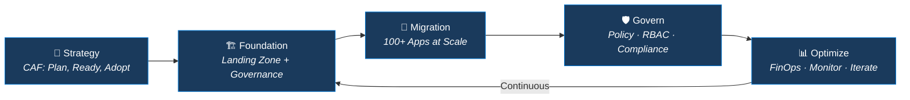
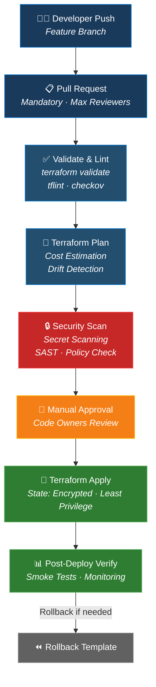

<!-- 
  ╔══════════════════════════════════════════════════════════════════════════════╗
  ║                                                                            ║
  ║   🏗️  RAHUL GOYAL — Enterprise Cloud Architect & DevSecOps Strategist      ║
  ║   📐  14+ Years | Azure | Terraform | Landing Zones | Cloud Migrations     ║
  ║                                                                            ║
  ╚══════════════════════════════════════════════════════════════════════════════╝
-->

<div align="center">

<!-- ═══════════════════════ HERO BANNER ═══════════════════════ -->


<!-- ═══════════════════════ TYPING ANIMATION ═══════════════════════ -->

<br/>

<a href="https://github.com/rahulgoyaldevops">
  
</a>

<br/>

<!-- ═══════════════════════ QUICK IDENTITY ═══════════════════════ -->

```
┌─────────────────────────────────────────────────────────────────────────────┐
│                                                                             │
│   Role        ►  Enterprise Cloud Architect & Technical Account Manager     │
│   Experience  ►  14+ Years  ·  Infrastructure + Application Architecture   │
│   Domains     ►  Cloud Migrations · Landing Zones · DevSecOps · FinOps     │
│   Scale       ►  100+ Application Migrations · Multi-Subscription Estates  │
│   Philosophy  ►  Scalable · Secure · Governed · Cost-Optimised · Portable  │
│                                                                             │
└─────────────────────────────────────────────────────────────────────────────┘
```

<!-- ═══════════════════════ IMPACT BADGES ═══════════════════════ -->


</div>

---

## 🧠 The Architect's Mindset

> *Most engineers deploy resources. I design **enterprises**.*
> 
> *When a CTO asks to "migrate 100+ applications across dev, UAT, and production into Azure with multi-subscription governance" — I don't just write Terraform. I engineer the tenant hierarchy, the management group structure, the hub-spoke networking, policy guardrails, the RBAC model, the FinOps framework, DR resilience, monitoring observability, trunk-based branching, vendor SOWs, and team upskilling. Then I build it. Then I govern it.*

<br/>

<div align="center">



</div>

---

## 🏛️ What I Actually Architect (Not Just Buzzwords)

<table>
<tr>
<td width="50%" valign="top">

### ☁️ Cloud Foundation & Landing Zone
```
Microsoft Entra ID
  └── Tenant Root Group
       ├── Platform MG
       │    ├── Identity Subscription
       │    ├── Management Subscription
       │    └── Connectivity Subscription
       ├── Landing Zone MG
       │    ├── Corp (Online) MG
       │    └── SAP / Specialized MG
       ├── Sandbox MG
       └── Decommissioned MG
```
- CAF-driven strategy: **Plan → Ready → Adopt → Govern → Secure → Manage**
- Subscription boundaries, policy initiatives, RBAC group formation
- Subscription onboarding/offboarding automation
- Policy exemptions with justification workflows

</td>
<td width="50%" valign="top">

### 🌐 Hub-Spoke Network Architecture
```
   ┌────────────────────────────┐
   │        HUB VNET            │
   │  ┌──────┐  ┌───────────┐  │
   │  │Azure │  │ VPN GW /  │  │
   │  │ FW   │  │ExpressRte │  │
   │  └──┬───┘  └─────┬─────┘  │
   │     │            │         │
   │  ┌──┴────────────┴──┐     │
   │  │  Private DNS Zones│     │
   │  └──────────────────┘     │
   └────────┬───────┬──────────┘
            │       │
    ┌───────┴─┐ ┌───┴───────┐
    │ Spoke 1 │ │  Spoke N  │
    │ (Prod)  │ │  (UAT)    │
    │ UDR→FW  │ │  UDR→FW   │
    └─────────┘ └───────────┘
```
- IP address management & CIDR planning
- On-premises CIDR assessment & integration
- Centralized inspection & controlled egress
- Private endpoints & DNS resolution chain
- UDR firewall rules & NSG hardening

</td>
</tr>
<tr>
<td width="50%" valign="top">

### 🔐 Security — Defense in Depth
| Layer | Controls |
|:--|:--|
| **Identity** | Entra ID, Conditional Access, PIM, MFA |
| **Network** | NSG, Azure Firewall, Private Link, WAF |
| **Governance** | Azure Policy, Initiatives, Defender for Cloud |
| **Compute** | Defender for Servers, JIT Access, Bastion |
| **Data** | Encryption at rest/transit, Key Vault, CMK |

</td>
<td width="50%" valign="top">

### 💰 FinOps & Cost Intelligence
```
 FinOps Lifecycle
 ┌──────────┐    ┌──────────┐    ┌──────────┐
 │ INFORM   │───▶│ OPTIMIZE │───▶│ OPERATE  │
 │          │    │          │    │          │
 │ Cost     │    │ Right-   │    │ Reserved │
 │ Visibility│   │ Sizing   │    │ Capacity │
 │ Tagging  │    │ Idle     │    │ Auto     │
 │ Budgets  │    │ Resources│    │ Start/   │
 │ Alerts   │    │ Disk     │    │ Stop     │
 └──────────┘    │ Cleanup  │    │ Retention│
                 └──────────┘    │ Tuning   │
                                 └──────────┘
```

</td>
</tr>
</table>

---

## ⚙️ Terraform & DevSecOps Pipeline Architecture

<div align="center">



</div>

<details>
<summary><b>🔍 My Terraform & Pipeline Best Practices (Click to Expand)</b></summary>
<br/>

| Area | Practice |
|:--|:--|
| **State Management** | Remote state (Azure Blob), least privilege access, encryption at rest, state locking |
| **Module Design** | DRY reusable modules, semantic versioning, input validation, output contracts |
| **Branching** | Trunk-based strategy, short-lived feature branches, no delete on main, CODEOWNERS |
| **Pipeline Templates** | Validate → Test → Build → Deploy → Apply → Rollback (reusable YAML templates) |
| **Quality Gates** | Linting (tflint), security scan (checkov/tfsec), cost estimation (infracost), policy (OPA/Sentinel) |
| **Drift Detection** | Scheduled `terraform plan` via pipelines, drift alerts to Slack/Teams |
| **Secrets** | Zero hardcoded credentials. Managed Identity & Azure Key Vault integrated natively |
| **Parallel Jobs** | Parallelized plan/apply across independent modules for execution velocity |

</details>

---

## 🔄 Cloud Migrations — Battle-Tested at Scale

<div align="center">

```
┌──────────────────────────── MIGRATION FACTORY ──────────────────────────────┐
│                                                                             │
│  ┌──────────┐   ┌──────────┐   ┌──────────┐   ┌──────────┐   ┌──────────┐ │
│  │DISCOVERY │──▶│ASSESSMENT│──▶│READINESS │──▶│ MIGRATE  │──▶│HYPERCARE │ │
│  │          │   │          │   │          │   │          │   │          │  │
│  │ App      │   │ 6R       │   │ Pre-     │   │ Cutover  │   │ Post-    │  │
│  │ Inventory│   │ Strategy │   │ Checklist│   │ Windows  │   │ Checklist│  │
│  │ Dependency│  │ TCO/ROI  │   │ Landing  │   │ Parallel │   │ Sign-off │  │
│  │ Mapping  │   │ Analysis │   │ Zone     │   │ Run      │   │ KT       │  │
│  │          │   │          │   │ Ready    │   │          │   │          │  │
│  └──────────┘   └──────────┘   └──────────┘   └──────────┘   └──────────┘ │
│                                                                             │
│  ► 100+ Applications · Dev/UAT/Prod · Multi-Subscription · On-Prem → Cloud │
│  ► Pre, During & Post migration checklists for zero-surprise cutovers      │
│                                                                             │
└─────────────────────────────────────────────────────────────────────────────┘
```

</div>

---

## 🎯 Beyond Technology — Enterprise Leadership

> *A 14-year career isn't just about code. It's about leading teams, vendor governance, winning multimillion-dollar proposals, and owning delivery end-to-end.*

<table>
<tr>
<td width="33%" align="center">

### 📋 Vendor & Delivery
- Scope, Deliverables, Acceptance Criteria
- Sprint planning & dependency mapping
- SOW review & commercial negotiations
- RFP/RFI response & technical evaluation
- Escalation matrix design
- Payment milestone tracking
- Weekly reviews & retro governance

</td>
<td width="33%" align="center">

### 👥 Team & Transitions
- Team upskilling strategy & KT sessions
- Senior-level technical interview panels
- RACI matrix & documentation handover
- Cutover transition planning & execution
- Service ownership & operational excellence
- SOP creation & process governance
- Cross-functional stakeholder alignment

</td>
<td width="33%" align="center">

### 🏆 Service Ownership
- End-to-end cloud platform ownership
- Pre-sales & enterprise architecture proposals
- High-impact POC design & execution
- Estimation & capacity planning
- Architecture review boards (ARB)
- Audit & compliance defense
- Executive C-level stakeholder management

</td>
</tr>
</table>

---

## 🤖 AI-Augmented Engineering

> *Every senior architect must master AI: not just generic chat, but integrating GenAI and intelligent automation into production workflows.*

| AI Capability | How I Apply It |
|:--|:--|
| **AI-Assisted IaC** | GitHub Copilot & LLMs for Terraform module generation and static analysis |
| **AIOps & Observability** | Anomaly detection in Azure Monitor, log anomaly clustering, proactive capacity prediction |
| **GenAI Documentation** | Automated runbook updates, Architecture Decision Records (ADRs), post-mortem generation |
| **AI in Security** | Microsoft Copilot for Security, prompt-driven incident correlation, SIEM telemetry enrichment |
| **Enterprise Azure OpenAI** | Architecture of secure Azure OpenAI private endpoints, RAG pipelines, Vector Search |

---

## 📌 Featured Production Architectures & Repositories

| Repository | Focus Area | Tech Stack |
| :--- | :--- | :--- |
| **[tf-monolithic-landing-zone](https://github.com/rahulgoyaldevops/tf-monolithic-landing-zone)** | Enterprise Azure Landing Zone with parent/child modules, Key Vault integration & Infracost | `Terraform`, `AzureRM`, `Key Vault`, `Infracost` |
| **[terraform-github-actions](https://github.com/rahulgoyaldevops/terraform-github-actions)** | Production Terraform CI/CD pipeline using GitHub Actions with passwordless Azure OIDC | `GitHub Actions`, `Terraform`, `Azure OIDC`, `Security` |
| **[azure-devsecops-pipeline-templates](https://github.com/rahulgoyaldevops/azure-devsecops-pipeline-templates)** | Enterprise pipeline templates for Azure DevOps: Validate, Checkov, TFLint & Drift Detection | `Azure DevOps`, `Checkov`, `TFLint`, `Gitleaks` |
| **[cloud-migration-playbook](https://github.com/rahulgoyaldevops/cloud-migration-playbook)** | End-to-end 100+ app migration factory: 6R decision trees, pre/post checklists & cutovers | `Migration Factory`, `6R Strategy`, `Checklists`, `Governance` |
| **[azure-finops-governance-toolkit](https://github.com/rahulgoyaldevops/azure-finops-governance-toolkit)** | Cost governance toolkit: automated idle VM/disk detection & Terraform tagging policies | `FinOps`, `PowerShell`, `Azure Policy`, `Cost Management` |
| **[kubernetes-production-aks](https://github.com/rahulgoyaldevops/kubernetes-production-aks)** | Multi-zone production AKS cluster architecture: Calico CNI, Azure AD RBAC, Key Vault CSI | `Kubernetes`, `AKS`, `Calico`, `Terraform`, `ArgoCD` |

---

## 🛠️ Technology Arsenal

<div align="center">

**Cloud Platforms & Architecture**<br/>


**Infrastructure as Code & Automation**<br/>


**Containers & Orchestration**<br/>


**CI/CD & DevSecOps**<br/>


**Observability & FinOps**<br/>


</div>

---

## 📈 GitHub Activity

<div align="center">


</div>

<div align="center">


</div>

---

## 🤝 Let's Connect

<div align="center">

<a href="https://rahulgoyal.co.in">
  
</a>
<a href="https://www.linkedin.com/in/rahulgoyaldevops/">
  
</a>
<a href="https://medium.com/@rahulgec04">
  
</a>
<a href="mailto:rahulgoyal.devops@gmail.com">
  
</a>

</div>

<br/>

<div align="center">

```
╔═══════════════════════════════════════════════════════════════════════════╗
║                                                                         ║
║   "I don't build servers. I architect enterprises that scale,           ║
║    self-heal, self-govern, and survive their architects leaving."        ║
║                                                                         ║
║                                          — Rahul Goyal                  ║
║                                                                         ║
╚═══════════════════════════════════════════════════════════════════════════╝
```

</div>

<div align="center">


</div>

<!-- ═══════════════════════ FOOTER WAVE ═══════════════════════ -->

