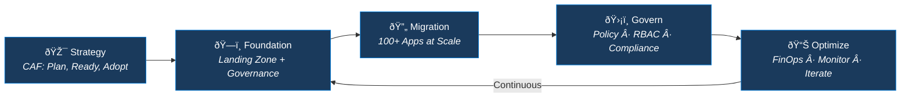
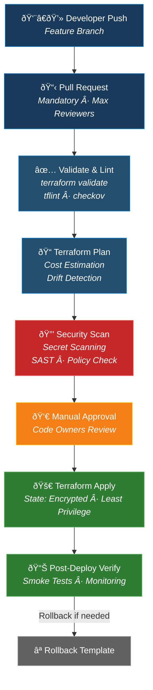

<!-- 
  ╔══════════════════════════════════════════════════════════════════════════════╗
  â•‘                                                                            â•‘
  ║   🏗️  RAHUL GOYAL — Enterprise Cloud Architect & DevSecOps Strategist      ║
  ║   📐  14 Years | Azure | Terraform | Landing Zones | Cloud Migrations      ║
  â•‘                                                                            â•‘
  ╚══════════════════════════════════════════════════════════════════════════════╝
-->

<div align="center">

<!-- ═══════════════════════ HERO BANNER ═══════════════════════ -->


<!-- ═══════════════════════ TYPING ANIMATION ═══════════════════════ -->

<br/>

<a href="https://github.com/rahulgoyaldevops">
  
</a>

<br/>

<!-- ═══════════════════════ QUICK IDENTITY ═══════════════════════ -->

```
┌─────────────────────────────────────────────────────────────────────────────┐
│                                                                             │
│   Role        ►  Enterprise Cloud Architect & Technical Account Manager     │
│   Experience  ►  14+ Years  ·  Infrastructure + Application Architecture   │
│   Domains     ►  Cloud Migrations · Landing Zones · DevSecOps · FinOps     │
│   Scale       ►  100+ Application Migrations · Multi-Subscription Estates  │
│   Philosophy  ►  Scalable · Secure · Governed · Cost-Optimised · Portable  │
│                                                                             │
└─────────────────────────────────────────────────────────────────────────────┘
```

<!-- ═══════════════════════ IMPACT BADGES ═══════════════════════ -->


</div>

---

<!-- ═══════════════════════════════════════════════════════════════════════════
     SECTION 1: THE ARCHITECT'S MINDSET
     ═══════════════════════════════════════════════════════════════════════════ -->

## 🧠 The Architect's Mindset

> *Most engineers deploy resources. I design **enterprises**.*
> 
> *When a CTO asks "migrate 100+ applications across dev, UAT, and production into Azure with
> multi-subscription governance" — I don't just write Terraform. I design the tenant hierarchy,
> the management group structure, the hub-spoke networking, the policy guardrails, the RBAC model,
> the FinOps framework, the DR strategy, the monitoring observability stack, the branching strategy,
> the vendor SoW, and the team upskilling plan. Then I build it. Then I govern it.*

<br/>

<div align="center">



</div>

---

<!-- ═══════════════════════════════════════════════════════════════════════════
     SECTION 2: ENTERPRISE ARCHITECTURE
     ═══════════════════════════════════════════════════════════════════════════ -->

## 🏛️ What I Actually Architect (Not Just Buzzwords)

<table>
<tr>
<td width="50%" valign="top">

### ☁️ Cloud Foundation & Landing Zone
```
Microsoft Entra ID
  └── Tenant Root Group
       ├── Platform MG
       │    ├── Identity Subscription
       │    ├── Management Subscription
       │    └── Connectivity Subscription
       ├── Landing Zone MG
       │    ├── Corp (Online) MG
       │    └── SAP / Specialized MG
       ├── Sandbox MG
       └── Decommissioned MG
```
- CAF-driven strategy: **Plan → Ready → Adopt → Govern → Secure → Manage**
- Subscription boundaries, policy initiatives, RBAC group formation
- Subscription onboarding/offboarding automation
- Policy exemptions with justification workflows

</td>
<td width="50%" valign="top">

### 🌐 Hub-Spoke Network Architecture
```
   ┌────────────────────────────┐
   │        HUB VNET            │
   │  ┌──────┐  ┌───────────┐  │
   │  │Azure │  │ VPN GW /  │  │
   │  │ FW   │  │ExpressRte │  │
   │  └──┬───┘  └─────┬─────┘  │
   │     │            │         │
   │  ┌──┴────────────┴──┐     │
   │  │  Private DNS Zones│     │
   │  └──────────────────┘     │
   └────────┬───────┬──────────┘
            │       │
    ┌───────┴─┐ ┌───┴───────┐
    │ Spoke 1 │ │  Spoke N  │
    │ (Prod)  │ │  (UAT)    │
    │ UDR→FW  │ │  UDR→FW   │
    └─────────┘ └───────────┘
```
- IP address management & CIDR planning
- On-premises CIDR assessment & integration
- Centralized inspection & controlled egress
- Private endpoints & DNS resolution chain
- UDR firewall rules & NSG hardening

</td>
</tr>
<tr>
<td width="50%" valign="top">

### 🔐 Security — Defense in Depth
| Layer | Controls |
|:--|:--|
| **Identity** | Entra ID, Conditional Access, PIM, MFA |
| **Network** | NSG, Azure Firewall, Private Link, WAF |
| **Governance** | Azure Policy, Initiatives, Defender for Cloud |
| **Compute** | Defender for Servers, JIT Access, Bastion |
| **Data** | Encryption at rest/transit, Key Vault, CMK |

</td>
<td width="50%" valign="top">

### 💰 FinOps & Cost Intelligence
```
 FinOps Lifecycle
 ┌──────────┐    ┌──────────┐    ┌──────────┐
 │ INFORM   │───▶│ OPTIMIZE │───▶│ OPERATE  │
 │          │    │          │    │          │
 │ Cost     │    │ Right-   │    │ Reserved │
 │ Visibility│   │ Sizing   │    │ Capacity │
 │ Tagging  │    │ Idle     │    │ Auto     │
 │ Budgets  │    │ Resources│    │ Start/   │
 │ Alerts   │    │ Disk     │    │ Stop     │
 └──────────┘    │ Cleanup  │    │ Retention│
                 └──────────┘    │ Tuning   │
                                 └──────────┘
```

</td>
</tr>
</table>

---

<!-- ═══════════════════════════════════════════════════════════════════════════
     SECTION 3: TERRAFORM & DEVSECOPS
     ═══════════════════════════════════════════════════════════════════════════ -->

## ⚙️ Terraform & DevSecOps Pipeline Architecture

<div align="center">



</div>

<details>
<summary><b>🔍 My Terraform & Pipeline Best Practices (Click to Expand)</b></summary>
<br/>

| Area | Practice |
|:--|:--|
| **State Management** | Remote state (Azure Blob/S3), least privilege access, encryption at rest, state locking |
| **Module Design** | DRY reusable modules, semantic versioning, input validation, output contracts |
| **Branching** | Trunk-based strategy, short-lived feature branches, no delete on main, CODEOWNERS |
| **Pipeline Templates** | Validate → Test → Build → Deploy → Apply → Rollback (reusable YAML templates) |
| **Quality Gates** | Linting (tflint), security scan (checkov/tfsec), cost estimation (infracost), policy (OPA/Sentinel) |
| **Drift Detection** | Scheduled `terraform plan` via pipelines, drift alerts to Slack/Teams |
| **Secrets** | No secrets in code. Azure Key Vault / AWS Secrets Manager integrated into pipeline |
| **Parallel Jobs** | Parallelized plan/apply across independent modules for speed |

</details>

---

<!-- ═══════════════════════════════════════════════════════════════════════════
     SECTION 4: MIGRATION AT SCALE
     ═══════════════════════════════════════════════════════════════════════════ -->

## 🔄 Cloud Migrations — Battle-Tested at Scale

<div align="center">

```
┌──────────────────────────── MIGRATION FACTORY ──────────────────────────────┐
│                                                                             │
│  ┌──────────┐   ┌──────────┐   ┌──────────┐   ┌──────────┐   ┌──────────┐ │
│  │DISCOVERY │──▶│ASSESSMENT│──▶│READINESS │──▶│ MIGRATE  │──▶│HYPERCARE │ │
│  │          │   │          │   │          │   │          │   │          │  │
│  │ App      │   │ 6R       │   │ Pre-     │   │ Cutover  │   │ Post-    │  │
│  │ Inventory│   │ Strategy │   │ Checklist│   │ Windows  │   │ Checklist│  │
│  │ Dependency│  │ TCO/ROI  │   │ Landing  │   │ Parallel │   │ Sign-off │  │
│  │ Mapping  │   │ Analysis │   │ Zone     │   │ Run      │   │ KT       │  │
│  │          │   │          │   │ Ready    │   │          │   │          │  │
│  └──────────┘   └──────────┘   └──────────┘   └──────────┘   └──────────┘ │
│                                                                             │
│  ► 100+ Applications · Dev/UAT/Prod · Multi-Subscription · On-Prem → Cloud │
│  ► Pre, During & Post migration checklists for zero surprises              │
│                                                                             │
└─────────────────────────────────────────────────────────────────────────────┘
```

</div>

**My Migration Principles:**
- 📋 **Pre-checklist** before touching anything — network readiness, DNS, firewall rules, backup validation
- 🔄 **During-checklist** — parallel run, data sync verification, application health checks
- ✅ **Post-checklist** — performance baseline comparison, monitoring setup, stakeholder sign-off
- 🛡️ **Hypercare window** — dedicated support, rapid rollback capability, daily health dashboards

---

<!-- ═══════════════════════════════════════════════════════════════════════════
     SECTION 5: LEADERSHIP & ENTERPRISE SKILLS
     ═══════════════════════════════════════════════════════════════════════════ -->

## 🎯 Beyond Technology — Enterprise Leadership

> *A 14-year career isn't just about code. It's about building teams, managing vendors,
> winning proposals, and owning delivery end-to-end.*

<table>
<tr>
<td width="33%" align="center">

### 📋 Vendor & Delivery
- Scope, Deliverables, Acceptance Criteria
- Sprint planning & dependency mapping
- SOW review & commercial negotiations
- RFP/RFI response & technical evaluation
- Escalation matrix design
- Payment milestone tracking
- Weekly reviews & retro calls

</td>
<td width="33%" align="center">

### 👥 Team & Transitions
- Team upskilling strategy & KT sessions
- Senior-level interview panels
- RACI matrix & documentation handover
- Transition planning & execution
- New initiative ownership
- SOP creation & process governance
- Cross-functional collaboration

</td>
<td width="33%" align="center">

### 🏆 Service Ownership
- End-to-end service ownership
- Pre-sales & technical proposals
- POC design & execution
- Estimation & capacity planning
- Architecture review boards
- Compliance & audit readiness
- Stakeholder management

</td>
</tr>
</table>

---

<!-- ═══════════════════════════════════════════════════════════════════════════
     SECTION 6: BACKUP, DR & MONITORING
     ═══════════════════════════════════════════════════════════════════════════ -->

## 🛡️ Resilience Engineering — DR, Backup & Observability

<table>
<tr>
<td width="50%" valign="top">

### 💾 Backup & Disaster Recovery
```
  Primary Region                 Secondary Region
  ┌─────────────┐               ┌─────────────┐
  │  Production │──── GRS ────▶ │   DR Site    │
  │  Workloads  │               │  (Standby)   │
  │             │               │              │
  │  RTO: 1hr   │               │  Automated   │
  │  RPO: 15min │               │  Failover    │
  └─────────────┘               └─────────────┘
  
  Storage Redundancy Options:
  LRS → ZRS → GRS → RA-GRS
  (Based on criticality & cost)
```
- VMSS for auto-scaling & high availability
- Retention period optimization (cost vs compliance)
- Automated backup validation & restore testing

</td>
<td width="50%" valign="top">

### 📊 Monitoring & Observability
```
  ┌─────────────────────────────────┐
  │      Azure Monitor / Grafana     │
  ├─────────────┬───────────────────┤
  │   Metrics   │     Logs          │
  │   ├ CPU     │  ├ Activity Logs  │
  │   ├ Memory  │  ├ Diagnostic     │
  │   ├ Disk    │  ├ Application    │
  │   └ Network │  └ Security       │
  ├─────────────┴───────────────────┤
  │        Alerts & Actions          │
  │  ├ Auto-scale triggers          │
  │  ├ Incident auto-creation       │
  │  └ Runbook automation           │
  └─────────────────────────────────┘
```
- Log ingestion optimization (cost-aware)
- Custom dashboards per stakeholder persona
- Proactive alerting with noise reduction

</td>
</tr>
</table>

---

<!-- ═══════════════════════════════════════════════════════════════════════════
     SECTION 7: AI & MODERN SKILLS
     ═══════════════════════════════════════════════════════════════════════════ -->

## 🤖 AI-Augmented Engineering

> *Every architect in 2026 must leverage AI — not just use ChatGPT,
> but integrate GenAI into infrastructure workflows.*

| AI Capability | How I Apply It |
|:--|:--|
| **AI-Assisted IaC** | GitHub Copilot for Terraform, AI-powered code reviews, intelligent module suggestions |
| **AIOps & Intelligent Monitoring** | Anomaly detection in Azure Monitor, AI-driven root cause analysis, predictive scaling |
| **GenAI for Documentation** | Automated runbook generation, architecture decision records, incident postmortems |
| **AI in Security** | Microsoft Copilot for Security, AI-powered threat detection, intelligent SIEM correlation |
| **Prompt Engineering for DevOps** | Custom GPT agents for pipeline troubleshooting, infrastructure Q&A bots for teams |
| **Azure OpenAI Integration** | Deploying Azure OpenAI Service, RAG pipelines, embedding models for enterprise search |

---

<!-- ═══════════════════════════════════════════════════════════════════════════
     SECTION 8: TECH STACK
     ═══════════════════════════════════════════════════════════════════════════ -->

## 🛠️ Technology Arsenal

<div align="center">

**Cloud & Infrastructure**


**Infrastructure as Code & Automation**


**Containers & Orchestration**


**CI/CD & DevSecOps**


**Monitoring & Security**


**AI & GenAI**


</div>

---

<!-- ═══════════════════════════════════════════════════════════════════════════
     SECTION 9: FEATURED REPOSITORIES
     ═══════════════════════════════════════════════════════════════════════════ -->

## 📌 Featured Architectures & Projects

<div align="center">

<a href="https://github.com/rahulgoyaldevops/tf-monolithic-landing-zone">
  
</a>
<a href="https://github.com/rahulgoyaldevops/terraform-github-actions">
  
</a>

</div>

> 💡 **Pro Tip:** Check my pinned repositories for production-grade Terraform modules,
> Azure DevOps pipeline templates, and enterprise landing zone blueprints.

---

<!-- ═══════════════════════════════════════════════════════════════════════════
     SECTION 10: GITHUB STATS
     ═══════════════════════════════════════════════════════════════════════════ -->

## 📈 GitHub Activity

<div align="center">


</div>

<div align="center">


</div>

<div align="center">


</div>

---

<!-- ═══════════════════════════════════════════════════════════════════════════
     SECTION 11: CONNECT
     ═══════════════════════════════════════════════════════════════════════════ -->

## 🤝 Let's Connect

<div align="center">

<a href="https://www.linkedin.com/in/rahulgoyaldevops/">
  
</a>
<a href="https://medium.com/@rahulgec04">
  
</a>
<a href="mailto:rahulgoyal.devops@gmail.com">
  
</a>

</div>

<br/>

<div align="center">

```
╔═══════════════════════════════════════════════════════════════════════════╗
â•‘                                                                         â•‘
â•‘   "I don't build servers. I architect enterprises that scale,           â•‘
â•‘    self-heal, self-govern, and survive their architects leaving."        â•‘
â•‘                                                                         â•‘
║                                          — Rahul Goyal                  ║
â•‘                                                                         â•‘
╚═══════════════════════════════════════════════════════════════════════════╝
```

</div>

<div align="center">


</div>

<!-- ═══════════════════════ FOOTER WAVE ═══════════════════════ -->


<!-- 
  ╔══════════════════════════════════════════════════════════════════════════════╗
  â•‘  Built with expertise, not templates. 14 years of battle scars included.   â•‘
  ╚══════════════════════════════════════════════════════════════════════════════╝
-->
