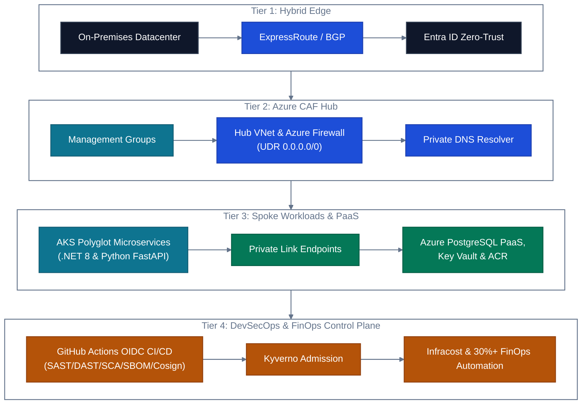

<!-- DYNAMIC TYPING HEADLINE -->

  

<!-- ACTIONABLE CONNECT BUTTONS (SYMMETRICAL BRANDING) -->

  
  &nbsp;
  
  &nbsp;
  
  &nbsp;
  

<!-- EXECUTIVE IMPACT METRICS (CLEAN, SYMMETRICAL TABLE) -->
<table>
  <tr>
    <td align="center" width="25%">
      

        <b>⏱️ 14+ Years Total IT</b> 
        <b>6.5+ Yrs Cloud & DevOps</b> Enterprise Platform Engineering
      

    </td>
    <td align="center" width="25%">
      

        <b>🚀 19 Enterprise Apps</b> 
        <b>Zero-Downtime Migrations</b> Multi-Subscription Scale
      

    </td>
    <td align="center" width="25%">
      

        <b>💰 30%+ FinOps ROI</b> 
        <b>Cloud Cost Optimization</b> Governance & Resource Tuning
      

    </td>
    <td align="center" width="25%">
      

        <b>🔐 Zero-Trust OIDC</b> 
        <b>Passwordless Pipelines</b> Continuous Drift Detection
      

    </td>
  </tr>
</table>

---

### 💼 Executive Profile

Senior / Lead DevSecOps Engineer with **14+ years of robust enterprise IT background**, including **6.5+ years of dedicated, hands-on leadership in Microsoft Azure Infrastructure Automation, Kubernetes Platform Engineering, large-scale Cloud Migrations, and DevSecOps**.

Combines the operational rigor, deep networking acumen, and disaster-recovery instincts of a 14-year systems veteran with modern cloud-native engineering (*modular Terraform, passwordless Azure OIDC federation, GitOps with ArgoCD, Calico microsegmentation, and FinOps cost governance*).

* **Enterprise Cloud Delivery:** Architected and executed the migration and platform onboarding of **19 enterprise business applications** across Dev, UAT, and Production into governed multi-subscription Azure environments with zero unplanned downtime.
* **Infrastructure as Code & Landing Zones:** Specialist in modular **Terraform Landing Zones**, Azure Cloud Adoption Framework (CAF) hierarchies, Hub-and-Spoke connectivity, forced-tunnel routing, and automated policy guardrails.
* **FinOps & Cost Governance:** Proven track record reducing enterprise cloud run-rate by **30%+** through automated idle workload deallocation, unattached storage reclamation, and telemetry log ingestion tuning.

---

### 📌 Featured Enterprise Engineering Blueprints

| Blueprint / Repository | Domain & Architecture | Core Stack | Status |
| :--- | :--- | :--- | :---: |
| **[aks-microservices-devsecops-platform](https://github.com/rahulgoyaldevops/aks-microservices-devsecops-platform)** | **Polyglot AKS Microservices DevSecOps Platform** .NET 8 + Python FastAPI + Azure PaaS + SAST/DAST/SCA/SBOM/Cosign/Infracost/Auto-Rollback | `.NET 8` `FastAPI` `AKS` `Azure PaaS` `Cosign` `Infracost` |  |
| 🏗️ **[azure-caf-landing-zone-terraform](https://github.com/rahulgoyaldevops/azure-caf-landing-zone-terraform)** | **Enterprise Azure Landing Zone** CAF Management Groups, Hub-Spoke, UDR, NSGs, Key Vault | `Terraform` `Azure CAF` `Infracost` |  |
| 🔄 **[terraform-github-actions](https://github.com/rahulgoyaldevops/terraform-github-actions)** | **Passwordless Azure CI/CD Pipeline** GitHub Actions, OIDC Workload Identity, Drift Detection | `GitHub Actions` `OIDC` `DevSecOps` |  |
| ☸️ **[kubernetes-production-aks](https://github.com/rahulgoyaldevops/kubernetes-production-aks)** | **Production-Grade AKS Platform** Multi-Zone AKS, Calico CNI, GitOps, Workload Identity | `Kubernetes` `AKS` `ArgoCD` `Calico` |  |
| 🔒 **[azure-devsecops-pipeline-templates](https://github.com/rahulgoyaldevops/azure-devsecops-pipeline-templates)** | **Enterprise DevSecOps Pipeline Library** Shift-Left Security Gates, Checkov, TFLint, Gitleaks, Rollback | `Azure DevOps` `Checkov` `Gitleaks` |  |
| 📋 **[cloud-migration-playbook](https://github.com/rahulgoyaldevops/cloud-migration-playbook)** | **19-App Enterprise Migration Factory** 6R Rationalization, Cutover Window SOPs, Hypercare Framework | `Assessment` `Cutover` `Hypercare` |  |
| 💰 **[azure-finops-governance-toolkit](https://github.com/rahulgoyaldevops/azure-finops-governance-toolkit)** | **FinOps & Policy-as-Code Toolkit** Automated VMSS Scheduling, Orphaned Disk Cleanup, Tagging Policy | `PowerShell` `Azure Policy` `FinOps` |  |
| 🛡️ **[devsecops-cryptographic-resilience](https://github.com/rahulgoyaldevops/devsecops-cryptographic-resilience)** | **Cryptographic Resilience & Post-Mortem** Zero-Trust Web-PKI Gates, Entropy Scanners, Kyverno Admission | `Python` `Kyverno` `PKI` `Admission` |  |

---

### 🏛️ Core Architectural Pillars & Competencies

 

* **☁️ Cloud Foundations & Landing Zones:** Multi-tier Management Groups (*Platform, Corp, Online, Sandboxes*), Hub-and-Spoke transit routing with central Azure Firewall, UDR `0.0.0.0/0` forced tunneling, and enterprise Private Endpoints.
* **⚡ Infrastructure as Code & GitOps:** Modular, reusable Terraform architecture with state locking, variable-driven environment promotion (`dev`, `uat`, `prod`), Infracost shift-left budgeting, and ArgoCD Kubernetes sync.
* **🔄 Cloud Migration Factory (19 Enterprise Workloads):** Full lifecycle delivery using the 6R rationalization framework (*Rehost, Replatform, Refactor, Repurchase, Retire, Retain*), network latency baselines, cutover window runbooks, and hypercare governance.
* **🔐 Zero-Trust Security & DevSecOps:** Workload Identity Federation (no long-lived secrets), pre-commit security gates (`gitleaks`, `tflint`, `checkov`), PIM/Entra ID RBAC, and admission controllers.
* **💰 FinOps & High Availability:** Azure Policy-as-Code for tag enforcement, automated deallocation of idle compute, right-sizing storage, and zone-redundant architectures with documented BCDR playbooks.

### 🧭 Platform Leadership & Delivery Governance

* **Architecture Review Board (ARB) & ADRs:** Chair technical design reviews and maintain versioned Architecture Decision Records (ADRs) to standardize cloud landing zones, networking topology, and polyglot service patterns.
* **Zero-Trust DevSecOps & FinOps Governance:** Enforce shift-left security gates (SAST, DAST, SCA, SBOM, Cosign, Kyverno) and automated Infracost / Azure Policy-as-Code budget guardrails across every CI/CD pipeline.
* **Multi-Team Platform Enablement:** Build self-service golden paths, reusable Terraform/Helm modules, and automated rollback workflows that accelerate product squad onboarding while maintaining compliance.
* **Enterprise Migration & Vendor Alignment:** Lead cross-functional cutover governance, 6R workload rationalization, and executive alignment across cloud engineering, security, and third-party delivery vendors.

---

### 🛠️ Technical Arsenal

| Domain | Technologies & Tooling |
| :--- | :--- |
| **Cloud Platforms & Operating Systems** |     |
| **Infrastructure as Code & Automation** |       |
| **Containers & Orchestration** |      |
| **CI/CD & DevSecOps Security** |       |
| **Observability, Governance & FinOps** |      |

---

### 🤝 Let's Connect & Collaborate

  
  &nbsp;&nbsp;
  
  &nbsp;&nbsp;
  
  &nbsp;&nbsp;
  

Architecting scalable, resilient, and cost-efficient enterprise cloud infrastructure.

  

